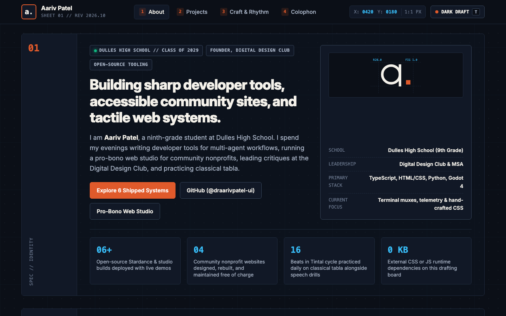

# Aariv Patel - My Personal Drafting Board & Technical Portfolio

**Live Site:** [https://aariv.me/personal-page/](https://aariv.me/personal-page/)



I built this site for the Hack Club Stardance **"Personal Site"** mission. Rather than using a generic template or a heavy JavaScript framework, I designed my personal website from scratch in vanilla HTML, CSS, and JavaScript to look and behave like a **Swiss architectural drafting sheet** (`SHEET 01 / REV 2026.10`).

---

## Why I Built It This Way

Over the past year I had built and shipped half a dozen separate developer tools, browser systems, and games across my GitHub repositories—plus pro-bono websites for student and community nonprofits—without having a single home page that tied all of my work together.

When I sat down to design my personal site for Stardance, I wanted the page itself to reflect the three disciplines I spend the most time on outside of writing code:
1. **Typographic grid systems** from founding and running the **Digital Design Club** at Dulles High School.
2. **Structured, zero-fluff argument** from competitive **Speech & Debate**.
3. **Mathematical rhythm and cyclical precision** from years of practicing classical North Indian **tabla**.

Designing the page as an interactive drafting board let me combine a live coordinate readout, numbered specification rails (`01` through `04`), filterable architecture cards for my shipped software, and an interactive **16-beat *Tintal* tabla cycle stepper** on a single zero-dependency sheet.

---

## Features & What Is on the Sheet

### 1. `01 // Identity & Spec (`#about`)`
- Introduces my work as a freshman at Dulles High School, founder of the Digital Design Club, and builder of open-source developer tools and pro-bono community nonprofit websites.
- Features a custom geometric SVG monogram (`a.`) framed by CAD-style radius and dimension callouts (`R28.0`, `FIG 1.0`) and a live metadata specification table.

### 2. `02 // Projects & Systems (`#projects`)`
- An interactive, filterable index of six projects I have built and shipped:
  - **Regatta**: Multi-agent terminal workspace in Electron using `node-pty`, `xterm.js` 16ms frame batching, and isolated `git worktree` lanes.
  - **wasitme**: Local-first coding session telemetry and git commit cadence analyzer.
  - **AarivOS**: 9-app browser operating system with a shared `localStorage` virtual file system and Web Audio synth.
  - **Pulse**: Keyboard-first browser new-tab dashboard with live NASA APOD integration and offline caching.
  - **Devlog Timer**: Hardware-inspired Pomodoro and devlog session tracker.
  - **Garlic Panic!**: WarioWare-style kitchen microgame rush built in Godot 4 and HTML5 Canvas.
- Click the category filter pills (`All`, `Developer Tools`, `Web Systems`, `Games`) or press `F` on your keyboard to cycle through categories with live count badges.

### 3. `03 // Design, Speaking & Tabla (`#craft`)`
- Explains how running interface critiques at the Digital Design Club, building accessible zero-maintenance sites for community groups like MSA, competing in Speech & Debate, and practicing classical tabla shape how I design software.
- **Interactive 16-Beat *Tintal* (`4 + 4 + 4 + 4`) Tabla Visualizer**: Click **Step Matra (`M`)** or press `M` on your keyboard to step beat-by-beat through all 16 *matras* of *Tintal*, displaying the traditional *bol* syllables (`Dha`, `Dhin`, `Tin`, `Ta`) and *vibhag* clap/wave markers (`Sam` on beat 1, `Tali` on 5 and 13, `Khali` wave on 9).

### 4. `04 // Colophon, Theme Tokens & Keyboard Shortcuts (`#colophon`)`
- **Dual Drafting Palettes**: Toggle instantly between **Dark Draft** (`#0b0f17` obsidian slate with `#e05a2b` drafting vermilion and `#38bdf8` blueprint cyan) and **Daylight Paper** (`#f5f2eb` warm archival vellum) via the top-right switch or the `T` hotkey.
- **Live Blueprint Cursor Readout**: Moving your cursor across the drafting sheet updates the `X / Y` millimeter-style coordinate indicator in the sticky specification header.
- **Full Keyboard Navigation**:
  - `1` / `2` / `3` / `4` -> Smooth-scroll directly to rails `01` through `04`
  - `T` -> Toggle between `Dark Draft` and `Daylight Paper` themes (saved in `localStorage`)
  - `F` -> Cycle through project category filters (`All` -> `Developer Tools` -> `Web Systems` -> `Games`)
  - `M` -> Advance one beat (*matra*) in the 16-beat *Tintal* tabla cycle

---

## What Was Tricky to Build

1. **Drawing a Crisp Blueprint Grid That Adapts to Both Themes**:
   Using a static background image for the drafting grid looked blurry on Retina displays and couldn't switch colors cleanly between dark obsidian and warm paper. I built the blueprint grid purely in CSS using layered `linear-gradient` rules driven by CSS custom properties (`--grid-line`), so switching themes repaints the entire drafting grid instantaneously with zero network requests.
2. **Keeping Layout Shifts Near Zero During Project Filtering**:
   When filtering the 6-card project grid down to 2 cards, sudden height collapses made the scroll position jump if you were triggering the `F` shortcut from the keyboard. Updating the visible card count badge and toggling `[hidden]` cleanly while keeping the section rail anchored prevented jarring viewport jumps.

---

## How to Run Locally

Visit **[https://aariv.me/personal-page/](https://aariv.me/personal-page/)** in your browser, or run it locally with zero dependencies:

```bash
git clone https://github.com/draarivpatel-ui/personal-page.git
cd personal-page
python3 -m http.server 8080
# Open http://localhost:8080
```

## Project Files

- `index.html` - Four-rail drafting sheet layout, SVG geometric monogram, project cards, and 16-beat *Tintal* tabla widget
- `styles.css` - Custom CSS design tokens (`Dark Draft` & `Daylight Paper`), responsive blueprint grid, and print-inspired typography
- `script.js` - Project category filter, interactive *Tintal* matra stepper, live cursor coordinate tracker, and keyboard shortcut router
- `screenshot.png` - Full-page screenshot of the drafting board
- `BUILD-LOG.md` - Step-by-step development notes

## License

MIT.
